<div align="center">

<picture>
  <source media="(max-width: 600px)" srcset="https://raw.githubusercontent.com/thangho98/thangho98/main/assets/hero-mobile.svg" />
  
</picture>

<br/>

[](https://github.com/thangho98)

[](mailto:thanglong2098@gmail.com)
[](https://thangho98.github.io)
[](https://github.com/thangho98)

</div>

## ⚡ About me

```go
package main

type Engineer struct {
	Name     string
	Base     string
	Focus    []string
	Building []string
	Hobbies  []string
}

var me = Engineer{
	Name:     "Thang Ho",
	Base:     "Vietnam 🇻🇳",
	Focus:    []string{"backend architecture", "multi-tenant SaaS", "system design"},
	Building: []string{"self-hosted media server", "dev tools", "MCP servers for AI agents"},
	Hobbies:  []string{"Linux ricing", "homelab", "breaking things to see how they work"},
}
```

## 🛠️ Tech stack

<div align="center">

**Languages**<br/>


**Backend & Data**<br/>


**Frontend**<br/>


**Infra & Tooling**<br/>


</div>

## 🚀 Featured projects

<table>
<tr>
<td width="50%" valign="top">

### 🎬 [Velox](https://github.com/thangho98/Velox)
Self-hosted media server for movies & TV — think Jellyfin/Emby, but faster, simpler, built from scratch.


</td>
<td width="50%" valign="top">

### 📸 [shotr](https://github.com/thangho98/shotr)
Screenshot beautifier for Linux, Windows & macOS — capture, annotate, redact, export. All on-device.


</td>
</tr>
<tr>
<td width="50%" valign="top">

### 📱 [claude-remote](https://github.com/thangho98/claude-remote)
Web UI for Claude Code CLI — chat, browse files, resume sessions from your phone.


</td>
<td width="50%" valign="top">

### 🤖 MCP servers for the homelab
Let AI agents drive real infra: [Nginx Proxy Manager](https://github.com/thangho98/npm-mcp-server) · [Cloudflare](https://github.com/thangho98/cloudflare-mcp) · [Uptime Kuma](https://github.com/thangho98/uptime-kuma-mcp)


</td>
</tr>
</table>

## 📊 GitHub stats

<div align="center">
  
  
</div>
<div align="center">
  
  
</div>

<br/>

<picture>
  <source media="(prefers-color-scheme: dark)" srcset="https://raw.githubusercontent.com/thangho98/thangho98/output/github-snake-dark.svg" />
  <source media="(prefers-color-scheme: light)" srcset="https://raw.githubusercontent.com/thangho98/thangho98/output/github-snake.svg" />
  
</picture>

<div align="center">

<sub>⚡ Built with coffee, Arch Linux and too many terminals · © 2026 Thang Ho</sub>


</div>
